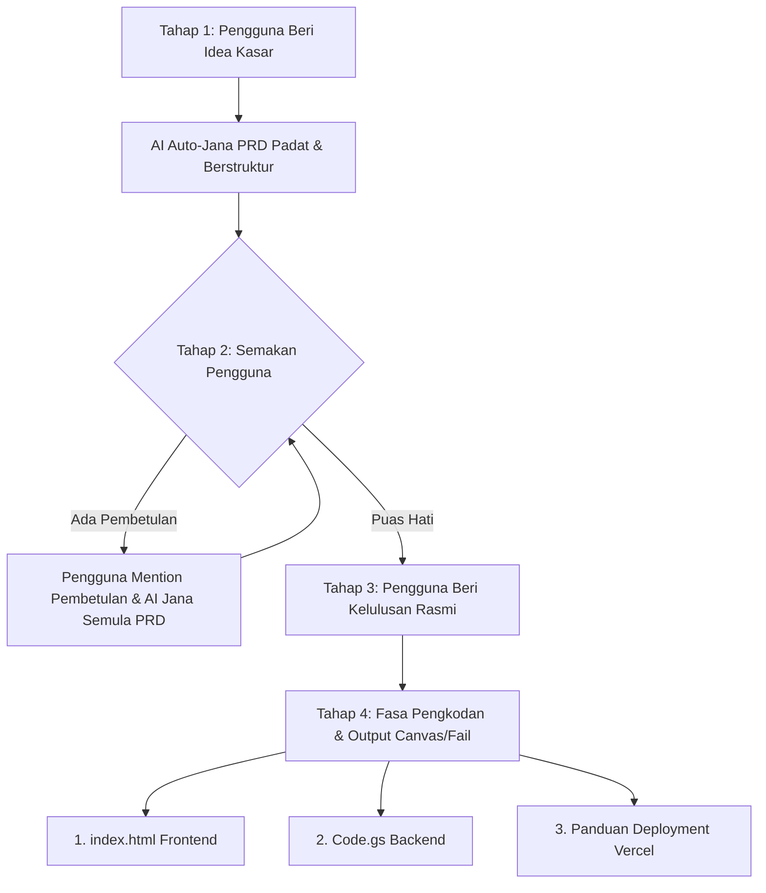

# 📘 Panduan Penggunaan WebApp Builder (GAS + Vercel) untuk AI Agent & Chat

Panduan ini menerangkan cara memasang dan memanfaatkan arahan kepakaran **`SKILL.md`** di dalam mana-mana platform AI Agent mahupun sesi perbualan Chat (seperti Claude, ChatGPT, Cursor, Windsurf, Cline, atau mana-mana LLM Agent).

---

## 🎯 Objektif Sistem

Sistem ini membolehkan anda membina aplikasi web penuh (*Full-Stack Web App*) bertaraf *Enterprise/SaaS* secara automatik daripada idea kasar anda:
- **Backend:** Google Apps Script (Headless JSON API) + Google Sheets (Pangkalan data idempotent berkunci `LockService`).
- **Frontend:** Satu fail utuh `index.html` moden berasaskan Tailwind CSS CDN, Lucide Icons, SweetAlert2, anti-logout semasa refresh pelayar, dan sifar butang mati.
- **Hosting / Deployment:** Vercel (kaedah muat naik fail HTML terus tanpa kompilasi/framework) atau Google Apps Script Web App.

---

## 🛠️ 1. Cara Memasang / Memuatkan Skill ke dalam AI

Pilih kaedah yang sesuai mengikut platform yang anda gunakan:

### Kaedah A: Claude Projects / Custom Instructions / ChatGPT GPTs
1. Buka projek baharu atau tetapan sistem prompt:
   - **Claude:** Masuk ke *Project* → buka bahagian *Project Knowledge* / *Instructions* → Muat naik fail `SKILL.md` atau salin seluruh kandungannya ke bahagian arahan.
   - **ChatGPT:** Cipta *Custom GPT* atau letakkan di *Custom Instructions* / *System Prompt*.
2. Mulakan perbualan dengan menyatakan idea aplikasi yang ingin dibina.

### Kaedah B: Editor AI (Cursor / Windsurf / Cline / Roo Code / omp)
1. Letakkan fail `SKILL.md` di dalam direktori kerja / root repositori projek anda:
   - Untuk **Cursor**: Boleh dirujuk di `.cursorrules` atau mention `@SKILL.md` di Chat.
   - Untuk **Windsurf / Cascade**: Boleh dirujuk di `.windsurfrules` atau mention `@SKILL.md`.
   - Untuk **Agent CLI (omp, dll)**: Rujuk secara terus fail `@SKILL.md`.

### Kaedah C: Sesi Chat Biasa (One-off Chat Session)
1. Salin keseluruhan teks dari `SKILL.md`.
2. Tampal ke dalam chat dengan awalan arahan ringkas:
   ```text
   Berikut ialah standard kejuruteraan dan alur kerja (SKILL) yang wajib kamu patuhi. Fahami arahan ini:
   [TAMPAL KANDUNGAN SKILL.MD DI SINI]
   ```
3. Kemudian hantarkan idea aplikasi anda.

---

## 🔄 2. Alur Interaksi 4 Tahap di Chat (Workflow Wajib)

AI yang mematuhi `SKILL.md` akan mengikut 4 tahap interaksi berikut secara berdisiplin:



### Tahap 1: Idea Kasar → PRD Automatik
- **Tindakan Anda:** Berikan idea ringkas (contoh: *"saya nak sistem e-tempahan kenderaan pejabat"*).
- **Tindakan AI:** AI **DILARANG** menyoal siasat dengan senarai soalan yang panjang. AI akan terus menganalisis dan menjana Dokumen Keperluan Produk (**PRD**) Padat & Berstruktur Tinggi (modul, aliran kerja Mermaid, skema Sheets, dan API actions).

### Tahap 2: Semakan & Mention Pembetulan
- Jika ada bahagian PRD yang perlu diubah, anda hanya perlu menyebut (*mention*) pindaan tersebut di chat (contoh: *"tukar login guna nombor staf, tambah status Kenderaan Diselenggara"*).
- AI akan menjana semula (*regenerate*) PRD secara harmoni tanpa merosakkan bahagian lain.

### Tahap 3: Pintu Kelulusan Rasmi (Approval Gate)
- **AI WAJIB BERHENTI** selepas menjana PRD dan menunggu kelulusan anda.
- Dilarang menulis kod sebelum anda memberi kata putus yang jelas seperti:
  * *"Setuju, sila buat kod"*
  * *"Ok proceed"*
  * *"Lulus, mulakan pengkodan"*

### Tahap 4: Fasa Pengkodan (Output Utuh)
AI akan mengeluarkan 3 output mengikut urutan:
1. **Frontend `index.html`:** Satu fail utuh lengkap (HTML + Tailwind Play CDN + Lucide Icons + SweetAlert2 + JS reaktif).
2. **Backend `Code.gs`:** Satu fail kod lengkap Google Apps Script mengikut standard pengeluaran (LockService, batch operations, salted hash SHA-256).
3. **Petunjuk Deployment:** Langkah penyediaan Google Sheet, tetapan Apps Script, dan cara deploy frontend ke Vercel.

---

## 💬 3. Contoh Skrip Perbualan (Cheatsheet Prompt)

### 📌 Contoh 1: Memulakan Projek (Tahap 1)
> *"Saya mahu buat sistem pengurusan aduan kerosakan fasiliti sekolah. Ada peranan Pengadu (guru/staf) dan Admin (juruteknik). Rujuk @SKILL.md dan hasilkan PRD padat."*

### 📌 Contoh 2: Meminta Pindaan PRD (Tahap 2)
> *"Kemas kini PRD: Tambah satu medan 'Kategori Aduan' (Elektrik, Paip, Perabot, ICT) dan admin boleh muat naik status gambar selepas dibaiki."*

### 📌 Contoh 3: Meluluskan PRD untuk Mula Kod (Tahap 3)
> *"PRD nampak mantap dan lengkap. Saya bersetuju. Sila teruskan dengan fasa pengkodan sekarang."*

### 📌 Contoh 4: Memohon Penambahan Fitur Selepas Kod Siap
> *"Sila kekalkan kod sedia ada yang berfungsi. Tambah fungsi eksport laporan senarai aduan bulanan ke format CSV pada paparan admin."*

---

## 🚀 4. Langkah Menguji & Deployment ke Vercel

### Langkah A: Pengujian Segera di Komputer (Preview Mode)
1. Salin kod `index.html` yang dihasilkan oleh AI dan simpan di komputer anda sebagai fail `index.html`.
2. Secara lalai, pemboleh ubah di dalam `index.html` disetkan kepada mod pratonton:
   ```javascript
   const IS_PREVIEW = true; // Menggunakan data dummy / demo
   ```
3. Dwiklik fail `index.html` untuk membukanya di mana-mana pelayar web (Chrome, Edge, Safari).
4. Anda boleh mencuba log masuk menggunakan akaun demo yang disediakan pada skrin login (cth: Admin / Pengguna) untuk menguji seluruh UI, navigasi, dan fungsi butang.

---

### Langkah B: Penyediaan Backend Google Apps Script
1. Buka [Google Sheets](https://sheets.new) baharu.
2. Pergi ke menu **Extensions** (Pelanjutan) → **Apps Script**.
3. Padam kod asal, tampal kod penuh dari `Code.gs`.
4. Pilih fungsi `setupDatabase` di bar alat atas dan klik **Run** (Jalankan) untuk membina semua helaian secara automatik.
5. Pergi ke **Project Settings** (ikon gear ⚙️) → **Script Properties** → Tambah properti `TOKEN_SECRET` (masukkan sebarang teks rawak rahsia yang panjang).
6. Klik butang biru **Deploy** → **New deployment**:
   - Jenis: **Web app**
   - Description: `v1`
   - Execute as: **Me** (Akaun saya)
   - Who has access: **Anyone** (Sesiapa sahaja)
7. Klik **Deploy**, berikan kebenaran Google (**Authorize access**), dan salin **Web app URL** yang terhasil (berakhiran `/exec`).

---

### Langkah C: Menyambungkan Frontend ke Backend
1. Buka fail `index.html` dalam editor teks (cth: Notepad atau VS Code).
2. Cari konfigurasi di bahagian atas tag `<script>`:
   ```javascript
   const IS_PREVIEW = false; // Matikan mod pratonton (kotak demo akan hilang automatik)
   const GAS_URL = "https://script.google.com/macros/s/AKfycb.../exec"; // Masukkan URL GAS anda
   ```
3. Simpan perubahan fail `index.html`.

---

### Langkah D: Deployment ke Vercel (Kaedah Upload Fail Terus)

#### ⭐ Kaedah Utama: Muat Naik Fail Terus / Drag & Drop (Paling Mudah)
1. Masukkan fail `index.html` anda ke dalam satu folder (contoh nama folder: `app-saya`).
2. Layari [Vercel](https://vercel.com) dan daftar/log masuk akaun percuma anda.
3. Di halaman **Dashboard**, klik **"Add New..."** → pilih **"Project"**.
4. Di ruangan muat naik projek, seret dan lepaskan (*drag and drop*) folder `app-saya` tersebut ke Vercel (atau pilih folder dari komputer).
   > *Alternatif Terminal (CLI):* Jika anda memasang Node.js, buka terminal di folder tersebut dan jalankan:
   > ```bash
   > npx vercel
   > ```
5. Klik **"Deploy"**.
6. Dalam masa beberapa saat sahaja, aplikasi anda siap dilancarkan dengan URL rasmi percuma (contoh: `https://app-saya.vercel.app`) lengkap dengan HTTPS/SSL dan CDN global!

#### 🐙 Kaedah Alternatif: Sambungan GitHub (Pilihan / Optional)
1. Cipta repositori baharu di [GitHub](https://github.com) dan muat naik fail `index.html`.
2. Di Dashboard Vercel, pilih **"Import"** repositori GitHub tersebut.
3. Tetapkan *Framework Preset* kepada **"Other"** (*Static HTML*) dan klik **"Deploy"**.
4. Setiap kali anda mengemas kini kod di GitHub, Vercel akan mengemas kini laman web anda secara automatik.

---

## 🛡️ 5. Standard Kejuruteraan Utama (Peringatan Penting)

| Perkara | Standard Yang Ditetapkan |
|---|---|
| **Sifar Butang Mati** | Setiap butang WAJIB mempunyai logik hidup melalui atribut `data-action` (tiada butang hiasan/dummy). |
| **Sesi Tahan Refresh** | Status log masuk disimpan dalam `localStorage`. Halaman tidak akan auto-logout apabila direfresh. |
| **Mod Tema** | 100% Tema Terang (*Light Mode*) yang bersih dan profesional. Tiada mod gelap (*Dark Mode dilarang*). |
| **Responsif 100%** | Dwi-navigasi ketat: Desktop menggunakan navigasi standard, manakala Mobile menggunakan Thumb-Zone Bottom Nav. |
| **Keselamatan Password** | Hash kata laluan SHA-256 + salt unik. Admin wajib mempunyai antara muka untuk menukar kata laluan. |
| **Integrasi Sheet GAS** | Operasi baca/tulis secara kelompok (*batch* `getValues` & `setValues`) dilindungi transaksi `LockService`. |
